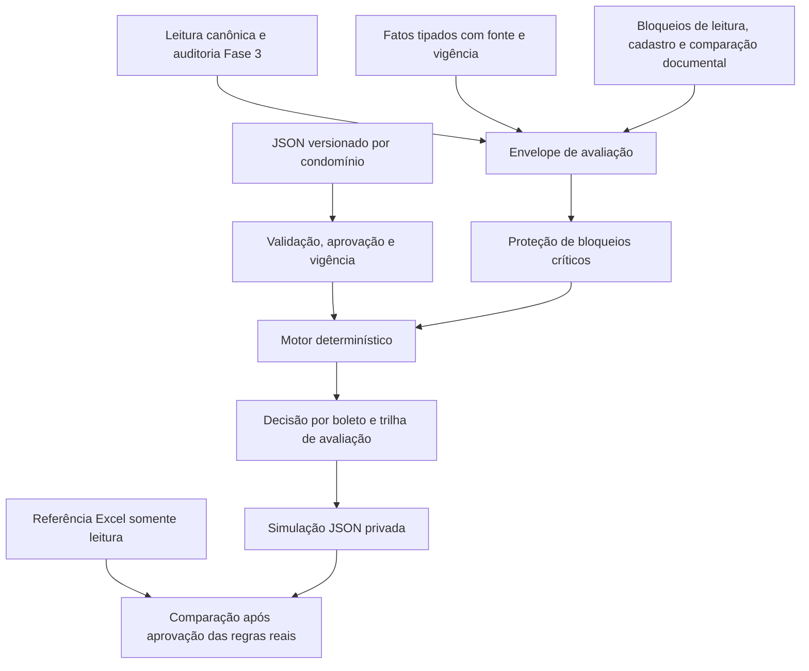

# Fase 4 — proposta de arquitetura e decisões operacionais

Status atual: **arquitetura aprovada para o incremento 4.1**, implementado conforme
[contratos, schemas, persistência e proteção das aprovações](INCREMENTO_4_1_PLANOS_E_APROVACOES.md).
O texto abaixo preserva a proposta original e o roteiro futuro. Não há motor
geral de avaliação implementado nem regra real ativada. A aprovação posterior
corrige D02: exclusões/bloqueios de unidade prevalecem, mas permissão genérica
de unidade não libera boleto inelegível. Não houve autorização para 4.2 ou Fase 5.
A Fase 3 está tecnicamente encerrada com ressalvas, sem homologação para produção.

## 1. Base preservada e preparação do Git

- `AGENTS.md`, plano 01, especificação 02 e `ACEITE_TECNICO_FASE3.md` consultados.
- `main` sincronizada com `origin/main` após fetch: `410f7d6`, sem novos commits
  remotos nesta consulta. Nenhuma alteração da Fase 3 foi descartada.
- Correções aprovadas e encerramento da Fase 3 preservados no commit local
  `8ddb782`, na branch `feature/fase-3-leitores`.
- Branch exclusiva `feature/fase-4-motor-cobranca` criada a partir de `origin/main`
  e avançada por fast-forward para incorporar a base aprovada da Fase 3. A `main`
  não recebeu merge nem alterações locais. Não houve push.
- A Fase 3 ainda não está na main remota: a publicação futura da Fase 4 depende
  da revisão/publicação da base Fase 3; até lá, um PR contra main conteria ambas.
- Regressão reexecutada: **398 testes regulares + 60 explícitos = 458**. Mantidos
  contratos, leitores, auditoria, CPF/CNPJ textual na coluna literal CPF e as
  evidências aceitas de 884 boletos e 132 correspondências financeiras.

A conferência desta preparação também validou a sintaxe do JSON ilustrativo,
os schemas existentes e `git diff --check`. Não foram adicionados testes de um
motor inexistente nem executadas novas comparações financeiras reais.

## 2. Arquitetura proposta

O motor recebe o modelo canônico, fatos complementares comprovados e o conjunto
completo de bloqueios. Não lê PDFs, interpreta texto livre ou escreve Excel.
Novos condomínios usam configuração; o núcleo não consulta nome de administradora.

| Componente proposto | Responsabilidade |
|---|---|
| `domain/billing_rules.py` | Plano, cláusulas, condições tipadas, políticas de resolução e fatos; sem I/O |
| `rules/conditions.py` | Comparações tipadas e lógica de três valores: verdadeiro, falso, indeterminado |
| `rules/engine.py` | Avaliar unidade/boleto; prioridades; conflitos; uma decisão final por boleto |
| `application/billing.py` | Selecionar plano aprovado, conferir envelope e preservar bloqueios antes/depois da avaliação |
| `application/billing_ports.py` | Interfaces de planos, aprovações, fatos, impedimentos e simulações |
| `adapters/billing_json.py` | JSON atômico, revisão otimista, hashes, referências e histórico; substituível por PostgreSQL |
| `application/billing_simulation.py` | Simulação sem exportação; diferenças classificadas e rastreáveis |
| `schemas/regras/1.0/` e `tests/rules/` | Contratos versionados e regressão sintética |

Estes caminhos são propostos; não foram criados módulos executáveis nesta etapa.
`rules/laboratory.py` continua isolado no laboratório sintético: não é fallback
para planos reais nem fonte de aprovação. Não migrar automaticamente os contratos
planos de `CondicaoRegra`/`RegraCobranca` do catálogo 1.0 para uma semântica nova.

## 3. Modelo JSON proposto

Exemplo completo, sintético e não executável em
[`examples/fase4/plano_regras.proposta.json`](../examples/fase4/plano_regras.proposta.json).
Os números, datas e ações ilustram o contrato, não aprovam uma régua real.

| Entidade | Campos e invariantes propostos |
|---|---|
| Plano de regras | `schema_version`, `id`, `condominio_id`, `versao`, vigência `[de, ate)`, fontes, políticas e cláusulas |
| Cláusula | ID estável dentro da versão, prioridade inteira, alvo `unidade`/`boleto`, condição, ação, código de motivo e fonte operacional |
| Condição | Árvore `todas`/`qualquer`/`nao`, predicado tipado e quantificador explícito `existe_boleto`/`todos_boletos`; sem `eval`, Python ou SQL embutido |
| Valores | Monetários em strings decimais exatas; dias inteiros; datas ISO explícitas; apontamento com código **e namespace** |
| Fato complementar | Condomínio, unidade/boleto, chave tipada, valor, fonte/hash/página/linha, vigência, versão e confirmação; ausência não significa falso |
| Aprovação | Eventos separados, somente acrescentados: propor, revisar, aprovar, revogar; responsável, evidência, instante com fuso e hash do conteúdo aprovado |
| Ativação | Requer plano válido, aprovação explícita do hash, vínculo ao condomínio e vigência na data de referência; zero ou duas versões aplicáveis impedem execução |
| Simulação | IDs e hashes do lote, plano, fatos, impedimentos, versão do motor e data de referência; decisões e trilhas; sem arquivo de cobrança |

O estado de aprovação é derivado do histórico, não basta escrever `aprovada` no
JSON. Aprovar demanda comando explícito do responsável com evidência; registrar
um ID sozinho não equivale a autenticação/assinatura digital. Plano aprovado é
imutável; correção cria versão nova. Revogação acrescenta evento, sem apagar
aprovação anterior. Alterar qualquer condição/fonte/política invalida o hash.
Reprodução histórica fixa versões e revisão do histórico; não reativa plano revogado.

O catálogo 1.0 e seus testes ficam preservados. A proposta usa documento separado
de plano e repositório próprio, com referência validada ao condomínio do catálogo.
Isso evita mudar silenciosamente a interpretação das regras da fundação. Uma
migração futura de regras antigas precisa ser explícita, validada e aprovada.

### Campos iniciais e lacunas de dados

- Dias de atraso: diferença assinada entre `data_ref` e vencimento; operadores
  `gt/gte/lt/lte/eq` explícitos. Nunca usar `today`, arredondar ou truncar atraso
  futuro para zero silenciosamente.
- Valor original do boleto e valores de composição tipados; não usar saldo
  acumulado como original nem modificar valores reconciliados.
- Apontamentos: código e namespace preservados; A/AJ/J não viram automaticamente
  status jurídico, e notas administrativas não viram decisões de cobrança.
- Status jurídico, garantidora e outros fatos tipados: exigem fonte e vigência.
  Não estão preenchidos universalmente no canônico atual. Não criar fatos a partir
  de notas livres nem considerar fato ausente como inexistência de processo/garantia.
- Condições sobre unidade usam o conjunto inteiro de boletos daquela unidade,
  antes de filtrar por prazo; isso permite exclusão por qualquer boleto gatilho.
- Competência Habita permanece nula. O motor não a calcula nem preenche.
  Elegibilidade de cobrança e prontidão cadastral/exportação são estados distintos.

Um registro de fatos tipados permite ampliar critérios configuráveis sem colocar
nomes de administradora ou condomínio no algoritmo. Um tipo/operador desconhecido
gera erro de validação, nunca execução aproximada ou avaliação de texto livre.

## 4. Preservação obrigatória dos bloqueios

O envelope deve reunir `LoteCanonico`, ocorrências de `LeituraCanonica`, evidências
documentais e impedimentos privados registrados separadamente. Receber só o lote
não basta: os dois conflitos contra referência podem não estar no PDF/Cadastro
isolado. A entrada deve provar a presença dos artefatos obrigatórios por IDs/hashes
e estado explícito da revisão. Envelopes incompletos, hashes divergentes ou
ocorrências sem escopo resolvível impedem a simulação conclusiva.

Bloqueio de lote domina todos os boletos; bloqueio de cadastro/unidade acompanha
todos os boletos relacionados. O cálculo das regras pode gerar candidatos
diagnósticos, mas a decisão final continua `bloquear`; candidatos não são cobranças
liberadas. Nenhuma prioridade, exclusão, inclusão ou opção de simulação remove
ocorrência crítica ou escolhe CPF/CNPJ/titular. A saída repete os impedimentos e
verifica que nenhum sumiu. Não haverá argumento `ignorar_bloqueios`.

Habita/VG permanece bloqueado; as 34 associações FL e os dois conflitos de CPF
(duas ocorrências em uma unidade) permanecem em revisão. Endereço ambíguo também
permanece bloqueado em seu cadastro. A futura exportação mantém a restrição atual
de recusar lote com ressalva crítica; esta proposta não autoriza liberação parcial.

## 5. Decisões operacionais para aprovação

As políticas abaixo são **propostas**, ainda não regras aprovadas. Os bloqueios
da seção anterior já são requisitos obrigatórios e não estão em votação.

| ID | Decisão | Proposta inicial | Impacto |
|---|---|---|---|
| D01 | Sentido da prioridade | Número maior vence entre decisões terminais do mesmo escopo; ordem do JSON não decide | Evita dependência da ordem de cadastro |
| D02 | Unidade versus boleto | Aprovação posterior: exclusão/bloqueio de unidade prevalece; permissão da unidade não libera boleto individualmente inelegível | Políticas registradas em 4.1; avaliação futura em 4.2 |
| D03 | Empate incompatível | Bloquear escopo para revisão; nenhuma precedência implícita entre incluir/excluir/adiar | Não escolhe resultado financeiro arbitrariamente |
| D04 | Sem regra ou condição indeterminada | Resultado pendente e impedimento de inclusão no escopo; nunca incluir por padrão | Exige cobertura explícita da régua e fatos suficientes |
| D05 | Ação alertar | Acumular avisos sem decidir inclusão; desempate de regras com a mesma ação preserva todas as justificativas | Alerta sozinho não libera cobrança |
| D06 | Prazos reais e ação judicial/garantidora | Confirmar por condomínio operador exato, dias, escopo, modalidade e efeito; sem padrão global 30/60 | Necessário antes das simulações financeiras reais |
| D07 | Fontes jurídicas, garantidora e exceções | Usar apenas fatos comprovados, tipados e vigentes; definir responsável/fonte por condomínio | Fonte ausente ou conflitante permanece pendente |
| D08 | Competência e cadastro antecipado | Manter competência ausente; não criar política geral de linha cadastral | Mapeamento eventual exige aprovação; materialização XLSX fica na Fase 5 |
| D09 | Governança da aprovação | Eventos locais auditados com hash e evidência; revisão explícita de cada plano real, sem interpretar planilha automaticamente | Não supõe que o protótipo forneça controle de acesso de produção |

Em D04, a lógica composta tem três valores: falso domina `todas`, verdadeiro
domina `qualquer`, e o restante pode ser indeterminado. Uma condição não satisfeita
não vira lacuna por conter um ramo que não afeta seu resultado. O quantificador
`todos_boletos` não deve incluir unidade vazia por verdade vacuamente satisfeita;
na proposta, exige conjunto não vazio. Estes casos entram nos testes de contrato.

Os parâmetros específicos de TREE/FL no documento 02 são requisitos a confrontar
com a fonte operacional e formalizar num plano aprovado. A autorização de iniciar
a Fase 4 não aprova automaticamente uma nova interpretação desses parâmetros.
Não foi fornecido nesta etapa um plano real estruturado e aprovado. A Régua bruta,
que pode conter credenciais, permanece fora do repositório e deve ter caminho
privado autorizado antes de qualquer inspeção; não é enviada a serviços externos.

## 6. Saída auditável proposta

Cada boleto recebe exatamente uma decisão final, mesmo se o lote estiver bloqueado:
ação, motivo, unidade/boleto, plano e versão, cláusulas candidatas/vencedoras,
data de referência, fatos/valores comparados, origem do gatilho e origem do próprio
boleto, fontes das regras, impedimentos e conflitos. Uma exclusão por unidade
referencia o boleto/apontamento que a disparou em todas as decisões afetadas.

`ResultadoCobranca` permanece compatível; a trilha detalhada fica em contrato
complementar de simulação. Bloqueios técnicos não inventam uma regra operacional:
a trilha identifica sua camada de segurança e a ocorrência original. Não alterar
o modelo antigo para fabricar uma aprovação quando não houver plano válido.
Falha de seleção/aprovação produz relatório de recusa, sem decisões financeiras.

Os JSONs detalhados são privados, gravados atomicamente com permissão restrita.
Console retorna apenas IDs técnicos/códigos/contagens seguros. Excel de referência
é somente leitura e nunca fonte para completar fatos ou alterar as regras.
Comparação será feita após aprovação dos planos reais, classificando divergências
de extração, cadastro, regra, representação e referência; não buscar coincidência
artificial com 132 linhas. Nenhuma cobrança real será exportada nesta fase.

## 7. Incrementos após aprovação

| Incremento | Implementação prevista | Verificação |
|---|---|---|
| 4.1 | Modelos/schemas, portas e JSON de planos/eventos; fixtures sintéticas | Tipos, versões, referências, vigências, hash/aprovação, imutabilidade, atomicidade e concorrência |
| 4.2 | Avaliador puro e resolução de regras conforme D01–D05 | Limites estritos/inclusivos, vencimento futuro, Decimal, AND/OR/NOT, fatos ausentes, namespace, escopo e conflitos |
| 4.3 | Envelope, proteções e simulação auditável sintética | Exclusão por gatilho em toda unidade, precedência de bloqueios, preservação documental, uma decisão por boleto, repetibilidade e ausência de exportação |
| 4.4 | Formalizar planos reais com revisão/aprovação D06–D09; só então simular na área privada | Preservar 884 boletos, fontes e retenções; comparar referências sem alterar finanças |

Executar os 458 testes anteriores e os novos testes pertinentes a cada incremento.
Nenhum teste real/sensível entra no Git. O primeiro incremento só será implementado
após revisão desta proposta; simulação privada real depende também da aprovação
dos planos específicos. A Fase 5 permanece fora do escopo.
