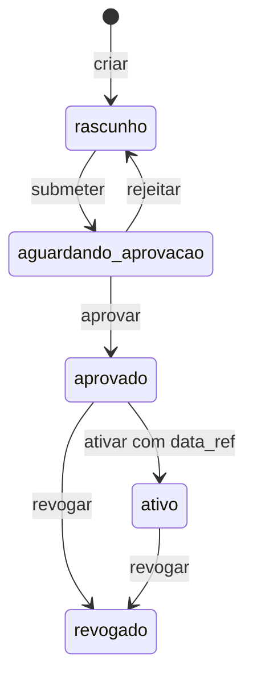

# Incremento 4.1 — contratos, schemas e repositório

Implementação limitada ao incremento autorizado. Não existe avaliador geral,
seleção de boletos, simulação financeira real ou exportação operacional nesta
entrega. A Fase 3 está tecnicamente encerrada, com ressalvas e todos os bloqueios
preservados. O sistema continua não homologado para produção.

## Contratos implementados

| Arquivo | Conteúdo |
|---|---|
| `src/conversor/domain/billing_rules.py` | Plano, cláusulas, condições recursivas, fatos declarados, políticas, comandos, eventos, registros e estados |
| `src/conversor/domain/billing_lifecycle.py` | Transições administrativas, reconstrução do histórico, referências, hashes e conflito de vigências ativas |
| `src/conversor/application/billing_ports.py` | Credencial em memória com representação oculta; porta transacional de repositório, sem salvar/importar snapshot arbitrário |
| `src/conversor/application/billing_plans.py` | Consulta de configuração ativa com data de referência explícita; não avalia nem autoriza boletos |
| `src/conversor/adapters/billing_authority.py` | Autorização por operador/ação/condomínio/ambiente, recibos HMAC e políticas históricas protegidas |
| `src/conversor/adapters/billing_json.py` | Gerações, manifesto assinado externo, leitura consistente, lock, concorrência otimista e commit atômico |
| `src/conversor/billing_schemas.py` | Geração/verificação determinística dos sete schemas em `schemas/regras/1.0/` |
| `examples/fase4/plano.sintetico.json` | Plano estrutural ilustrativo, sem registro, aprovação ou ativação |
| `tests/rules/` | Testes exclusivamente sintéticos de contratos, autoridade, integridade e concorrência |

O plano possui ID, condomínio, versão semântica, natureza, fontes, vigência
`[vigente_de, vigente_ate)`, políticas e cláusulas com ID/prioridade/alvo/ação/
motivo/fonte. Valores financeiros são strings decimais exatas com duas casas;
float, exponencial, NaN e arredondamentos não são aceitos. Não se executa nenhuma
operação financeira.

Condições tipadas: dias de atraso, valor original, apontamento com namespace,
fato declarado, `todas`, `qualquer`, `nao`, `existe_boleto` e `todos_boletos`.
Validam-se tipos/operadores, fontes, fatos, escopos, IDs únicos e limites da árvore.
Não há interpretação de texto livre ou execução de expressão Python/SQL.
O contrato declara exigência de fonte/vigência para fatos, mas não coleta nem
avalia fatos reais neste incremento.

A restrição aprovada posterior corrige D02 da proposta: **excluir/bloquear unidade
prevalece sobre seus boletos; uma permissão da unidade não libera boleto
individualmente inelegível**. As políticas também preservam prioridade maior,
revisão de empate incompatível, ausência de inclusão presumida e superioridade
imutável dos bloqueios críticos. Esses valores não podem ser trocados por opções
que removam as restrições. Sua execução será objeto do incremento 4.2.

Os schemas são estruturais. Hashes, autorizações, referências entre entidades,
transições e sobreposições também exigem as validações Python e a autoridade.
Um JSON que passa no schema não é, por isso, aprovado. O namespace é separado do
catálogo 1.0; regras antigas e o laboratório não foram migrados automaticamente.

Documentação modificada: `01_PLANO_ETAPAS.md`, `02_ESPECIFICACAO_PRODUTO.md`,
`README.md` e `docs/ARQUITETURA_MOTOR_FASE4.md`. Testes criados:
`tests/rules/conftest.py`, `test_contracts.py`, `test_authority.py` e
`test_plan_repository.py` (todos no diretório `tests/rules/`).

## Estados e versionamento



Cada comando exige credencial autorizada, revisão esperada, instante ISO com fuso,
fundamento não vazio e ID de evidência. A credencial determina o responsável pelo
registro externo; o comando não aceita um responsável autodeclarado. Ações possuem
permissões distintas e o provisionamento pode separá-las por operador.
Não foi imposta aprovação por duas pessoas; o administrador pode conceder mais de
um papel ao mesmo responsável. A autenticação de produção permanece fora do escopo.

O conteúdo de toda versão é imutável **desde sua criação**, inclusive rascunhos.
Isso é uma escolha técnica conservadora: corrigir conteúdo demanda novo ID e nova
versão por condomínio; não se reescreve a versão que alguém revisou. Rejeitar volta
à condição de rascunho, preserva o conteúdo e o motivo e permite nova submissão.
Versão/ID repetidos são rejeitados. Revogado é terminal; a revisão posterior exige
novo plano. Aprovações múltiplas podem ser preparadas, mas planos ativos do mesmo
condomínio não podem ter intervalos sobrepostos. Para substituição sobreposta,
revogar o anterior antes de ativar o novo; pode existir intervalo sem plano ativo,
durante o qual a consulta falha de forma explícita. Vigências adjacentes são aceitas.

O hash SHA-256 abrange o conteúdo normalizado completo, incluindo condomínio,
versão, datas, fontes, políticas, fatos e cláusulas. Estado e histórico ficam fora
desse conteúdo, evitando hash circular. O hash da versão não muda ao aprová-la.
Cada evento referencia versão e hash exatos, responsável, fundamento, evidência,
instante, ambiente, hash do evento anterior e hash da política de autorização.

## Aprovação autorizada e proteção contra adulteração

A autoridade é provisionada explicitamente pelo administrador, em diretório
**externo à árvore do repositório de planos e fora do Git**:

- `chave.bin`: segredo HMAC aleatório com pelo menos 32 bytes; não é senha de
  administradora e nunca entra no conteúdo dos planos ou nos logs.
- `operadores.json`: concessões por responsável, hash SHA-256 de credencial
  aleatória de alta entropia, ações, condomínios e ambientes permitidos. O schema
  está em `autoridade.schema.json`; não inclui credenciais da Régua.
- `policies/<hash>.json`: cópia da política consultada em cada autorização.
- `<repositorio_id>.current.json`: manifesto assinado da revisão efetivamente
  publicada. O ponteiro confiável fica junto da autoridade, não nos planos.

Não existe autoprovisionamento de operador/chave ou aprovação por alteração de
campo JSON. A autoridade também rejeita diretório localizado dentro de checkout Git. A conta do serviço deve proteger essa raiz por ACL; em POSIX são
exigidos diretório sem acesso de grupo/outros e arquivos de autoridade 0600.
As credenciais de operação ficam apenas em memória; não são gravadas nos planos.
Provisionamento e distribuição de credenciais são responsabilidade administrativa,
sem login de produção implementado nesta etapa. Os testes criam chaves e tokens
aleatórios descartáveis em diretórios temporários e não os imprimem.

A autorização confere a credencial contra o registro externo e verifica ação,
condomínio e ambiente. O recibo HMAC-SHA-256 assina todos os campos do evento. Na
leitura, são verificados o recibo, a permissão na política histórica arquivada, a
cadeia de eventos, o hash/conteúdo da versão e a projeção dos estados. Remover um
papel atual impede novas operações, preservando a autorização histórica; revogar
um plano exige evento próprio. Não se apaga a prova de quem aprovou.

O manifesto também tem HMAC e vincula repositório, caminho da raiz, ambiente,
revisão, geração e hash do snapshot. Assim, modificar `estado`, inserir aprovação,
trocar fonte/condição, truncar eventos ou restaurar um snapshot anterior
**somente na árvore de planos** não altera a revisão confiável. Recalcular um
SHA-256 sem possuir a autoridade não produz assinatura válida. Um `current.json`
manual na árvore dos planos é ignorado. Links simbólicos são rejeitados.

Limite de confiança: quem controla a chave, o registro externo, seu ponteiro ou o
processo autorizado controla a autoridade local. HMAC não é assinatura digital de
uma pessoa nem carimbo de tempo externo. Proteção contra administrador do sistema,
IAM externo, retenção WORM, recuperação antirollback do próprio domínio de
confiança e rotação/migração de chaves exigem desenho posterior. A implementação
não promete essas garantias. Rotação de chave sem migração falha de forma explícita;
restauração/mudança de caminho do repositório requer procedimento autorizado.
Os instantes dos comandos são explícitos e monotônicos no histórico, não timestamps
certificados por terceiro. Alterar a lista de responsáveis requer administração
confiável da autoridade; não é uma edição de plano pelo operador comum.

## Atomicidade e concorrência

A porta expõe `carregar()` e `executar(ComandoPlano, credencial, revisao_esperada)`.
A execução aqui é **de comando administrativo**, não de regra financeira. SQL
poderá implementar essa mesma porta e reutilizar a máquina de estados, sem mudar
os casos de uso ou os leitores. A consulta ativa também foi testada com outro
backend e rejeita estado inconsistente com o histórico.

A escrita bloqueia no diretório confiável, lê a revisão, revalida comando/contratos/
autorizações e acrescenta evento. Grava nova geração 0600, faz fsync e prepara o
manifesto temporário. `os.replace` no manifesto externo é o ponto único de commit.
Leitores mantêm a geração capturada e não observam metade da transação. Revisão
obsoleta é rejeitada; timeout do lock é explícito. Falha antes do commit mantém a
revisão anterior; gerações/políticas órfãs não ficam ativas. Não há coleta automática
de histórico. Após falha de fsync **posterior** à troca do manifesto, o resultado
pode ter sido publicado: consultar a revisão antes de repetir o comando.

A escrita atômica é testada em Linux/POSIX. Windows, filesystems remotos, ACLs e
recuperação de desastre ainda não foram homologados. O adapter nunca oferece
operação de substituir o histórico integral por um JSON importado.

## Execução local e evidências

```bash
.venv/bin/python -m pytest -q tests/rules
.venv/bin/python -m pytest -q
.venv/bin/python -m pytest -q tests/homologacao/pacote_suite.py tests/homologacao/revisao_suite.py tests/homologacao/leitores_fase3_suite.py
.venv/bin/python -m conversor.billing_schemas --check
.venv/bin/python -m conversor.schemas --check
.venv/bin/python -m conversor.recognition_schemas --check
```

Schemas novos: `plano`, `comando`, `evento`, `acervo`, `estado`, `manifesto` e
`autoridade`. Regenerar somente os novos com `python -m conversor.billing_schemas`.
O exemplo `plano.sintetico.json` passa no contrato, mas não está registrado, aprovado
ou ativo. `plano_regras.proposta.json` permanece como exemplo histórico não executável.

O teste de contrato verifica tipos, JSON/schema, datas explícitas, fontes, versão,
namespace, árvores e políticas. O teste de autoridade verifica credencial/papel/
condomínio/ambiente, responsável derivado, HMAC adulterado, política histórica,
recalcular hash sem chave, rollback da árvore de planos, estado sem histórico,
links/permissões, versão exata e ausência de segredos no console. O teste de
repositório verifica os cinco estados e as seis ações administrativas (incluindo rejeição
como retorno ao rascunho), aprovar antes de ativar, imutabilidade, vigência,
sobreposição, concorrência, leitura consistente, falhas de escrita e backend.

Resultado desta entrega: **137 testes novos; 535 regulares + 60 explícitos = 595
aprovados**, incluindo os 458 anteriores. Schemas anteriores e novos sincronizados.
Não houve alterações nos leitores, domínio canônico, exportador, 30 colunas ou
bloqueios críticos da Fase 3. Os 884 boletos/132 correspondências são evidências
anteriores preservadas; não foram realizadas novas seleções/comparações reais.

## Pendências para revisão do incremento 4.2

- Implementar somente após autorização o avaliador determinístico de condições,
  com lógica de três valores e tratamento de fatos ausentes/contraditórios.
- Detalhar a resolução entre ações de regras, principalmente `adiar` em unidade,
  alertas acumulados e bloqueios de negócio de prioridades distintas, mantendo as
  restrições superiores e a correção aprovada sobre permissões de unidade.
- Definir contrato/entrada dos fatos reais e seus responsáveis/fontes/vigências;
  nenhum apontamento ou status jurídico é interpretado por aproximação.
- Formalizar planos específicos de cada condomínio a partir de fonte privada
  autorizada e aprovação própria. A implementação de 4.1 não aprova prazos 30/60,
  limites, efeitos jurídicos, garantidora, exceções ou cadastro antecipado.
- Integrar posteriormente o envelope completo de impedimentos da Fase 3, incluindo
  conflitos documentais registrados separadamente. Consultar plano ativo não é
  autorização para contornar esses impedimentos nem para exportar.
- Manter competência Habita ausente. Não preencher por vencimento/emissão/descrição.

Apenas ambientes `sintetico` e `privado` são suportados; natureza sintética só é
aceita no primeiro, operacional só no segundo. **Produção não é ambiente aceito.**
Nenhum plano real foi criado/aprovado/ativado. Não se iniciou 4.2 nem a Fase 5.

## Registro de entrega no Git

Branch local: `feature/fase-4-motor-cobranca`. Implementação, exemplo, schemas e
testes no commit `612a94e`; documentação em commit separado. A base de Fase 3
(`8ddb782`) e a proposta de Fase 4 (`0fde5bf`) permanecem preservadas. Sem push ou
merge em main. A branch ainda inclui a base local de Fase 3 que não está na
referência `origin/main`; a publicação futura precisa considerar essa dependência.
A verificação local não encontrou cópias idênticas das cinco fontes reais nem
nomes completos, e-mails ou documentos válidos do canônico privado no conjunto
de arquivos versionáveis. Esse teste exato complementa a revisão de escopo;
não representa varredura universal de todo possível dado sensível.
