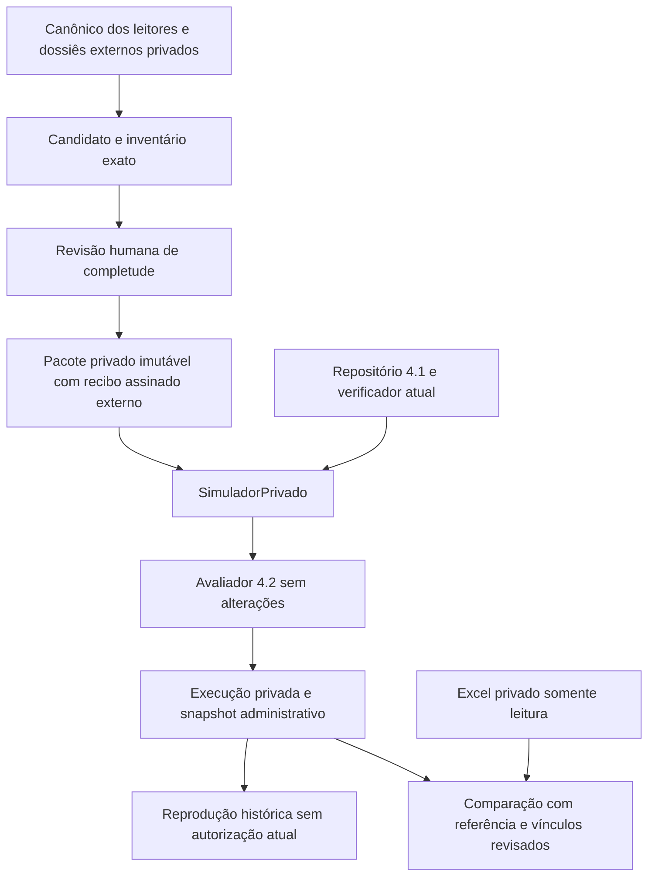

# Incremento 4.3A — preparação da homologação das regras reais

Infraestrutura implementada para revisão técnica. O 4.2 foi aceito com 716 testes.
Este incremento não implementa nem ativa planos de TREE/Plaza. Não executa cobrança,
não escreve XLSX operacional e não altera leitores, valores, competência,
CPF/CNPJ ou as 30 colunas. **Sistema não homologado para produção.**

Atualização corretiva posterior: a causa e a reconciliação das colisões FL estão
no [relatório de correção de identidades](CORRECAO_IDENTIDADES_AUDITORIA_4_3A.md).
Ele retifica a associação inicialmente descrita: os dois pares de registros são
internos ao dossiê documental. A ressalva de identidade foi corrigida; não houve
remoção de bloqueios ou aprovação de completude/regras reais. Os resultados abaixo
registram a primeira preparação 005 e sua suíte de 830 testes.

**Nota de histórico:** a matriz e as pendências de negócio deste relatório
registram o levantamento original. Os
[esclarecimentos posteriores do responsável](ATUALIZACAO_REQUISITOS_EXTRAJUDICIAL_FASE4_3B.md)
o superam quanto a centavo por unidade, filtro judicial e cadastro particular:
centavo exclui apenas cota/componentes; não há filtro judicial; cadastro é opção
universal A/B. Usar a [matriz revisada](MATRIZ_NEGOCIO_PRELIMINAR_8_REGRAS.md)
para decisões atuais, sem reescrever artefatos ou reprodução histórica. A decisão
TREE posterior confirmou A/AJ/J também como exclusões da cota/componentes,
independentes do vencimento; uma condição basta. Validação documental dos campos,
prioridades, vigências, aprovações técnicas/formais e atestos permanecem pendentes.

## Arquitetura e arquivos



| Arquivo em `src/conversor/` | Responsabilidade |
|---|---|
| `domain/private_simulation.py` | Candidato, pacote atestado, inventário, fontes, quatro catálogos, execução, recibo e replay histórico |
| `application/simulation_inventory.py` | Inventário por identidade/hash, ausências, fontes, consolidação segura e preservação de cobertura/bloqueios no resultado |
| `application/private_simulation_ports.py` | Portas de armazenamento, verificação histórica e comparação; substituíveis sem mudar casos de uso |
| `adapters/private_simulation_json.py` | JSON privado atômico, imutabilidade, assinatura, controle de concorrência, integridade e histórico HMAC 4.1 |
| `application/private_simulation.py` | Execução com pacote registrado, plano atual verificado, reprodução e comparação persistida |
| `domain/simulation_comparison.py` | Mapeamento explícito, divergências e relatório não operacional |
| `adapters/simulation_reference.py` | Leitura do Excel de referência; comparação de decisões, dados e representação |
| `domain/rule_preparation.py` | Matriz não executável e triagem de lacunas, ambiguidades e contradições estruturais |
| `private_simulation_schemas.py` | Oito schemas novos em `schemas/simulacao-privada/1.0/` |

A autoridade 4.1 ganhou uma operação pública de conferência da concessão histórica,
reutilizada por eventos antigos e recibos novos. Não mudou seu contrato de planos,
seus estados nem as permissões financeiras. Testes novos em
`tests/private_simulation/`: inventário, armazenamento, reprodução, comparação e
contratos/preparação. A matriz pública é
`examples/fase4/matriz_preliminar_4_3A.json`; contém requisitos de levantamento,
sem dados de clientes e sem formato de plano ativável.

## Completude e fronteira de confiança

O inventário inclui hash da entrada normalizada, identidade/hash de unidades,
boletos, pessoas, fatos, ocorrências, coberturas, ressalvas e catálogos; quantidades
de apontamentos e itens de composição; todas as origens; e caminhos de campos
ausentes. Esses caminhos incluem metadados opcionais: não são, por si, erros nem
bloqueios. Competência ausente continua nula. Nada é inferido a partir do vencimento.

Cada pacote exige exatamente quatro catálogos explícitos: `leitura`,
`auditoria_lote`, `titularidade` e `documentos`. Um catálogo vazio precisa ser
conferido pelo responsável, com fonte; erro de carga não vira vazio. A união das
ocorrências deve coincidir integralmente com a entrada; critério, severidade,
origens e evidências não podem ser descartados. Crítico sem fonte é recusado.
Repetição exatamente igual é idempotente; mesmo ID com conteúdo diferente bloqueia
a consolidação. Nenhuma evidência é escolhida ou mesclada por aproximação.

O candidato não possui atesto e é recusado pelo repositório de pacotes. Após revisão,
o responsável fornece atesto com instante e data de referência explícitos, fundamento, evidência e quatro
conferências afirmativas. `gravar_pacote` exige credencial registrada para `submeter`
no condomínio/ambiente. Essa permissão técnica registra o inventário; **não aprova
nem ativa plano de cobrança**. O responsável efetivo vem do cadastro da autoridade,
não de um nome livre no JSON. O recibo assinado vincula identidade, condomínio,
ambiente, raiz, conteúdo completo, responsável e política histórica.
Uma nova simulação exige a mesma data de referência do atesto; reutilizar o
inventário para outra data requer nova revisão e outro pacote. Isso não prova a
inexistência de evidências externas ainda não entregues ao responsável.

Uma declaração JSON de completude não basta para carregar o pacote: há recibo
externo autenticado. Depois do registro, eliminar entidade, ocorrência, página de
origem ou arquivo, trocar evidência, recalcular SHA ou editar o atesto invalida a
leitura. Não há atualização silenciosa: outro conteúdo requer outro ID e revisão.

**Limite explícito:** assinatura/inventário provam integridade do material revisado,
não que uma extração desconhecida encontrou tudo no PDF. O responsável precisa
conferir fontes, contagens e dossiês externos na criação inicial. Um operador
autorizado que atesta material incompleto viola essa fronteira de confiança; não
há prova automática da inexistência de um dossiê que nunca foi fornecido. Por isso
a preparação real abaixo permanece sem atesto. O host deve expor o fluxo
`SimuladorPrivado` para os dados privados; a biblioteca 4.2 em memória permanece
para chamadores confiáveis e não é um carregador autenticado de dossiês.

## Persistência, autoridade e reprodução

Fontes, repositório de simulações e autoridade precisam ficar fora de qualquer
checkout Git; links simbólicos são recusados. Em POSIX, raiz/âncoras usam 0700 e
arquivos 0600. A fonte é lida e confrontada com tamanho/SHA; não é alterada nem
copiada ao Git. A autoridade deve ficar separada do armazenamento editável.

O adapter grava temporário, faz fsync e troca atômica do objeto; depois grava o
recibo assinado na autoridade externa. Esse recibo é o único ponto de commit.
Falha anterior deixa, no máximo, órfão não legível. Lock e recusa de ID existente
impedem sobrescrita por dois escritores. Não existe API para editar/apagar histórico.

Uma execução guarda vínculo/hash do pacote, snapshot administrativo completo,
plano/versão/hash e provas de aprovação/ativação, fontes via pacote, data de
referência, decisões, condições, justificativas e bloqueios. Guarda também hash do
código de avaliação e versões de Python/Pydantic/openpyxl. Mesma entrada e mesmo
contexto produzem relatório idêntico, sem relógio implícito. Data administrativa
da execução é explícita e não participa da decisão financeira.
As fontes textuais do plano estão referenciadas por Origem/SHA no snapshot 4.1;
conferir e reter esses documentos faz parte da homologação específica do 4.3B.
Não foi implementado coletor ou interpretador de texto livre da régua.

Uma nova execução consulta o repositório 4.1 e o verificador atual antes/depois da
avaliação e após persistir. `ativo` isolado, assinatura ausente, versão/hash errado,
revogação, vigência incompatível ou mudança concorrente impedem devolver uma
execução atual. Mudança durante a gravação pode deixar evidência histórica já
comprometida, mas o método falha e não devolve resultado como atual. Não há transação
distribuída nem autorização duradoura de cobrança.

Replay verifica recibos, fontes, inventário, snapshot e cada evento/política
histórica 4.1; só então reavalia e exige igualdade do hash do relatório. Não reativa
planos. Pode reproduzir um snapshot hoje revogado, em envelope literal
`reproducao_historica_sem_autorizacao_atual`. Alteração de código/runtime ou falta
de fontes/chaves/políticas impede replay; preservar esses artefatos é requisito de
retenção. HMAC depende da proteção do host/chave/ACL, não implementa IAM, WORM,
assinatura pública ou defesa contra administrador que controla toda a autoridade.

Todos os envelopes mantêm `autoriza_cobranca=false` e
`permite_exportacao_operacional=false`. Não se conectam ao exportador.

### Uso local sob o host autorizado

Provisionar autoridade conforme o 4.1, fora do Git, com chave/credencial local
protegida e concessão técnica `submeter` restrita ao condomínio/ambiente. Não
salvar tokens/senhas de administradoras em nenhum desses objetos. A porta permite
outro backend; a implementação atual é JSON.

```python
from conversor.adapters.billing_evaluation_authority import VerificadorPlanosJSON
from conversor.adapters.private_simulation_json import (
    RepositorioSimulacoesJSON, VerificadorHistoricoHMAC,
)
from conversor.adapters.simulation_reference import ComparadorReferenciaXLSX
from conversor.application.private_simulation import SimuladorPrivado

# autoridade, repo_planos, pacote atestado, solicitação e credencial vêm do host
# confiável. Este trecho não os cria/aprova e não usa dados ou regras de clientes.
armazenamento = RepositorioSimulacoesJSON(
    '/workspace/validacao-privada-fase4/simulacoes',
    repositorio_id='homologacao_privada', ambiente='privado', autoridade=autoridade,
)
armazenamento.gravar_pacote(pacote, credencial=credencial)
simulador = SimuladorPrivado(
    armazenamento, repo_planos, VerificadorPlanosJSON(repo_planos),
    VerificadorHistoricoHMAC(autoridade_planos),
)
execucao = simulador.executar(
    id_=id_execucao, pacote_id=pacote.id, solicitacao=solicitacao,
    em=instante_explicito, fundamento=fundamento_tecnico,
    evidencia_id=evidencia_id, credencial=credencial,
)
historico = simulador.reproduzir(execucao.id)
comparacao = simulador.comparar(
    id_=id_comparacao, execucao_id=execucao.id, mapeamento=vinculos_revisados,
    template=template_universal, comparador=ComparadorReferenciaXLSX(),
    credencial=credencial,
)
assert simulador.reproduzir_comparacao(
    comparacao.id, comparador=ComparadorReferenciaXLSX(),
) == comparacao
```

O teste local inteiramente sintético, sem provisionamento real, é executável com
`.venv/bin/python -m pytest -q tests/private_simulation`. O script privado de
pré-conferência pode ser repetido com
`.venv/bin/python /workspace/validacao-privada-fase3/preparar_inventarios_4_3A.py`;
gera somente candidatos/pendências, sem credencial, aprovação ou avaliação real.

## Comparação com Excel de referência

Antes de comparar, o fluxo reproduz a simulação arquivada. Exige arquivo de
referência inventariado e vínculos revisados de linha → unidade/boletos/pessoa,
com hash da referência e evidência da revisão. Não associa pela posição do lote,
nome aproximado, CPF isolado ou vencimento semelhante. Os 390 cadastros não viram
unidades de inadimplência; só IDs do lote podem ser vinculados.

| Categoria | Evidência e limite |
|---|---|
| `regras` | Dívida na referência retida na simulação ou boleto elegível ausente de referência completamente mapeada; registra diferença de decisão, sem atribuir erro à regra |
| `dados` | Original, vencimento ou campo cadastral diverge; pode depender de enriquecimento, fonte ou composição financeira da referência, sem diagnóstico causal presumido |
| `formatacao` | Documento numérico/zeros perdidos verificáveis, representação de data, campo textual numérico ou espaço físico de AA |
| `nao_avaliavel` | Fórmula não executada, linha sem vínculo revisado, titular/documento não resolvido ou agrupamento com vencimentos diferentes |

Somar originais ocorre exclusivamente para diagnóstico de agrupamento explicitamente
vinculado. Não soma saldo acumulado, encargos ou descontos novamente. Não altera
dados, seleção ou regras para aproximar a planilha. Dados brutos divergentes ficam
fora do relatório de comparação; ele guarda hashes, IDs, campo, motivo, linha da
referência e origens/páginas dos boletos. Ainda assim, o relatório é privado.

Abre somente `Dados`, em leitura, sem executar fórmulas ou usar seu cache como
verdade financeira; exige 30 cabeçalhos na ordem original, com literal `CPF`.
Mantém a opção física já existente de espaço final em AA. Compara cadastro nas
colunas 3–24 e dívida nas 29–30, quando houver evidência/vínculo. As colunas 1–2 e
25–28 são explicitamente não avaliadas por dependerem de configuração/projeção
operacional. Não deriva competência de descrição. Linha cadastral é um vínculo
diagnóstico, não geração de cadastro antecipado. Importação easyCollector continua
pendência da Fase 5. A referência não é promovida a gabarito absoluto.

## Matriz preliminar por condomínio

Todas as linhas têm evidência `SOLICITACAO_4_3A`, aprovação **pendente**, prioridade
**não definida** e vigência **não definida**. Os IDs são referências de levantamento,
não cadastro operacional de condomínio nem plano real. Não há conversão automática
dessa matriz em `PlanoCobranca`, nem importador de texto livre/credenciais da régua.

| Condomínio | Condição / operador candidato | Escopo / ação candidata | Decisão humana necessária |
|---|---|---|---|
| TREE | Boleto R$ 0,01 / `eq` | Unidade / excluir | Campo monetário e universo examinado; prioridade e vigência |
| TREE | Apontamento A / `eq` | A confirmar | Namespace, significado, efeito e coexistência |
| TREE | Apontamento AJ / `eq` | A confirmar | Namespace, significado, efeito e coexistência |
| TREE | Apontamento J / `eq` | A confirmar | Namespace, significado, efeito e coexistência |
| TREE | Atraso superior a 30 / `gt` candidato | A confirmar | Contagem, referência, escopo e ação; não inferir competência |
| Plaza | Atraso superior a 30 / `gt` candidato | A confirmar | Contagem, referência, ação e relação com jurídico/cadastro |
| Plaza | Jurídico e prazo 60 / operador indefinido | A confirmar | Prova/vigência do status, marco inicial, `>` ou `>=`, efeito |
| Plaza | Cadastro antecipado / indefinido | A confirmar | Gatilho, cardinalidade, campos e interação com dívida; política do laboratório não é aprovação geral |

A triagem sinaliza metadados incompletos, semântica a confirmar, IDs duplicados,
vigência inválida e ações opostas com condição/escopo/prioridade idênticos e vigência
potencialmente sobreposta. Não prova equivalência entre condições diferentes nem
resolve ambiguidades semânticas de observações administrativas. Essas questões
continuam humanas, inclusive garantidora, jurídico e restrições superiores.

## Pré-conferência privada realizada, sem regras reais

Área: `/workspace/validacao-privada-fase3/resultados/preparacao_4_3A_005/`.
Script reprodutível privado: `preparar_inventarios_4_3A.py` na raiz privada.
Os cinco anexos mantêm SHA/tamanho do registro anterior; os JSON do dossiê da
revisão final permanecem byte a byte inalterados.

- Habita: candidato conferido estruturalmente, 112 unidades, 769 boletos,
  2.082 itens, 141 apontamentos e 2.309 origens distintas. Uma ocorrência externa
  crítica de subtotal preservada. As 769 competências continuam ausentes.
  Catálogos: 903 ocorrências de leitura e uma de auditoria do lote; categorias
  restantes explicitadas. **Sem atesto humano, recibo ou simulação real.**
- FL: canônico válido com 50 unidades e 115 boletos. A consolidação revelou
  **duas colisões de IDs entre os casos do próprio dossiê documental**, com
  evidências de origem diferentes (`DOCUMENTOS_CONFLITANTES` e
  `DOCUMENTO_TITULAR_NAO_CONFIRMADO`). Preparação bloqueada integralmente; nenhum
  registro foi escolhido, fundido ou descartado. Os dois lados foram retidos no
  relatório privado `fl.colisoes_privadas.json`. A correção rastreável de identidade
  foi implementada na etapa corretiva posterior, sem escolher documento/titular;
  registrar um pacote completo ainda exige atesto humano. Não é divergência
  de valor financeiro nem liberação das
  34 unidades ou dos dois conflitos de CPF existentes.

Os 884 boletos permanecem preservados; as 132 correspondências financeiras são
evidência anterior intacta, não uma nova comparação de regras reais. Não foi
executada simulação financeira real nem formalizada aprovação financeira.

## Testes e regressões

```bash
.venv/bin/python -m pytest -q
.venv/bin/python -m pytest -q tests/homologacao/pacote_suite.py tests/homologacao/revisao_suite.py tests/homologacao/leitores_fase3_suite.py
.venv/bin/python -m conversor.schemas --check
.venv/bin/python -m conversor.recognition_schemas --check
.venv/bin/python -m conversor.billing_schemas --check
.venv/bin/python -m conversor.evaluation_schemas --check
.venv/bin/python -m conversor.private_simulation_schemas --check
```

Resultado: **770 testes regulares + 60 explícitos = 830 aprovados**, sem falhas
ou skips no ambiente Linux. Preserva os 716 anteriores e acrescenta 114 casos.
Os cinco conjuntos de schemas passaram na conferência de sincronização.
Cobertura nova: completude/ausências, referências por identidade, fontes/ocorrências
omitidas ou parciais, colisão de ID com outra evidência, adulteração e recibos,
permissões/Git/links, escrita atômica e concorrência, aprovação/vigência/data,
revogação inclusive durante commit, preservação de bloqueios e documentos,
determinismo/replay, comparação de decisões/dados/representação, fórmulas,
vínculos ambíguos, contrato de 30 colunas e matriz não executável.
As novas fixtures são inteiramente sintéticas e temporárias, incluindo o Excel;
não há dependência dos anexos reais nos testes versionados.

## Critérios para autorizar o 4.3B

1. Aprovar condição, operador, campo, ação, escopo, prioridade e vigência de cada
   regra, com responsável e fonte autorizada; resolver a semântica jurídica dos
   60 dias e o cadastro antecipado. Configuração administrativa não substitui isso.
2. A correção rastreável de identidade FL foi implementada em etapa própria,
   preservando os registros e evidências. Conferir e atestar os inventários
   reconciliados completos e a relação de dossiês, incluindo os bloqueios de
   titularidade/documentos; a assinatura técnica não é esse atesto humano.
3. Registrar pacotes privados sob autoridade; aprovar vínculos com as referências
   e o significado de cada agrupamento/valor. Guardar fontes e ambiente de replay.
4. Definir data de referência explícita e criar/aprovar versões de planos pelo
   fluxo 4.1, somente no escopo privado autorizado. Não aprovar regras a partir de
   credenciais, acesso ou notas administrativas da régua.
5. Preservar o bloqueio Habita/VG e todos os impedimentos FL. Sua existência não
   impede estudo diagnóstico, mas impede qualquer autorização operacional e não
   pode ser removida para obter concordância financeira. Eventual saneamento exige
   evidência e decisão humana própria, fora da prioridade das regras.
6. Autorizar expressamente o próximo incremento e sua comparação financeira real.

O 4.3A prepara os mecanismos; a pendência de identidade exposta pela preparação
005 foi reconciliada na etapa corretiva documentada. As regras reais continuam
dependendo de decisões e aprovação próprias. **4.3B e Fase 5 não foram iniciados.**

## Registro da entrega

Branch `feature/fase-4-motor-cobranca`. Implementação, oito schemas, matriz e 114
testes novos no commit `e4c3a45`; documentação em commit separado. Os dez commits
anteriores permanecem preservados. Não houve push, merge ou atualização de main
nesta tarefa; a referência local `origin/main` continua sendo a base conhecida
anterior, sem consulta remota nova.

A conferência de privacidade revisou 192 arquivos versionáveis: nenhuma cópia
idêntica dos cinco anexos nem correspondência com os identificadores pessoais
conferidos no canônico privado. A raiz privada permanece fora do Git, com
permissões restritas. Essa conferência complementa a revisão e não constitui
garantia universal de detecção de todo dado sensível. Candidatos, colisões,
fontes e resultados privados não foram incluídos nos commits.
