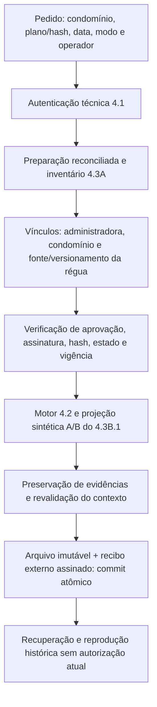

# Incremento 4.3B.2A — integração e persistência exclusivamente sintéticas

## Resultado e limites

Implementado o caminho integrado de preparação reconciliada, validação de plano,
avaliação pelo motor existente, seleção estruturada A/B e persistência assinada.
**1.111 testes aprovados: 1.027 anteriores + 84 novos. Oito verificações de schemas
aprovadas.** Não há novo motor, cálculo financeiro, XLSX ou envio de cobrança.

Este incremento não aprova/ativa planos reais, não emite atestos humanos e não
executa simulações sobre documentos privados. Os cinco anexos reais não foram
acessados. Habita/VG, cadastros FL e conflitos de CPF/CNPJ permanecem bloqueados.
Fase 5 não iniciada; sistema **não homologado para produção**.

## Arquitetura e sequência



O fluxo recebe somente o ID/hash de uma `PreparacaoTecnica` registrada pelo
armazenamento 4.3A. Não recebe lote canônico avulso ou ocorrências opcionais como
atalho ao inventário. Reutiliza `conferir_pacote`, reconciliação, verificação das
fontes físicas, históricos, quatro catálogos obrigatórios e assinaturas técnicas.
O candidato reconciliado não tem `AtestoCompletude`: conferência automática e
assinatura do recibo técnico **não equivalem a atesto humano**.

Antes de avaliar, o orquestrador confere a administradora do cadastro e de cada
unidade canônica, seu vínculo com o condomínio na data de referência e a natureza
sintética do contexto. Consulta as interfaces existentes de administradoras,
condomínios e planos, sem dependência do backend JSON nos casos de uso.

A referência de régua contém arquivo, versão e SHA-256. A versão é comprovada
pelo documento JSON **sintético** inventariado com papel `requisitos`; não basta
um rótulo de versão informado no pedido. As fontes aprovadas no plano devem
apontar para esse arquivo/hash, e os identificadores referenciados pelas regras
precisam existir no documento. Nenhum texto livre de particularidades,
credencial ou observação administrativa é convertido em condição financeira.

O motor e o serviço sintético 4.3B.1 produzem todas as avaliações e justificativas.
A nova camada apenas relaciona, verifica preservação, registra e recupera o
resultado; não reimplementa condições ou decisões financeiras.

## Arquivos e contratos aditivos

| Arquivo | Responsabilidade |
|---|---|
| `src/conversor/domain/integrated_processing.py` | Pedido integrado, régua sintética/versionamento, identidade e ato do operador, execução, reprodução e recibo |
| `src/conversor/application/integrated_processing_ports.py` | Portas de autenticação e armazenamento de processamentos, independentes de JSON |
| `src/conversor/application/integrated_processing.py` | Orquestração atual, conferência de vínculos/preservação e reprodução histórica |
| `src/conversor/adapters/integrated_processing_json.py` | Autenticação HMAC com autoridade 4.1 e extensão do armazenamento atômico/assinado 4.3A |
| `src/conversor/integrated_processing_schemas.py` | Gerador/conferidor de cinco schemas novos |
| `schemas/ensaio-integrado-sintetico/1.0/` | `regua`, `pedido`, `execucao`, `recibo` e `reproducao` |
| `tests/integrated_processing/conftest.py` | Preparação de fontes, autoridade, planos, catálogo e histórico inteiramente inventados em temporários |
| `tests/integrated_processing/test_pipeline.py` | 15 casos do caminho completo, A/B, idempotência e demonstração |
| `tests/integrated_processing/test_security.py` | 43 casos de aprovação, parâmetros, isolamento, fontes, identidades e bloqueios |
| `tests/integrated_processing/test_storage.py` | 26 casos de falha, concorrência, adulteração, preservação e schemas |

Documentação normativa, README e índice dos exemplos receberam referências ao
novo estágio. Contratos/schemas antigos, leitores, condições, motor, template e
exportadores permanecem inalterados.

O pedido inclui referência explícita, modo A/B sem default, identidade do plano e
hash, preparação/hash, administradora, régua/versão/hash, operador, instante com
fuso, fundamento não vazio e evidência do ato. A execução arquiva esses campos,
snapshots de condomínio/administradora e estado dos planos, prova do motor,
projeção completa e versão/hash da implementação.

`autoriza_cobranca`, `permite_exportacao_operacional` e `atesto_humano_emitido`
admitem somente `false`. Contratos Python verificam vínculos relacionais além
das restrições estruturais do JSON Schema.

## Controle de aprovação e atos independentes

O orquestrador reutiliza o repositório 4.1 e `VerificadorPlanosJSON`, antes e após
a avaliação e depois da gravação. Rascunho, aguardando aprovação, aprovado ainda
não ativo, revogado, inexistente, versão/hash incorretos, assinatura inválida,
condomínio errado ou referência fora da vigência são recusados. Um JSON marcado
como `ativo` sem eventos de aprovação/ativação é recusado mesmo quando o teste
fornece um manifesto sintético com assinatura válida.

A autorização técnica do operador reutiliza a permissão `submeter` da autoridade
4.1, limitada explicitamente ao ambiente sintético. Isso não concede aprovação
ou ativação. A identidade autenticada deve coincidir com a declarada no pedido.
O ato registra função `operador`, ação `processar_ensaio_sintetico`, responsável,
instante, fundamento, evidência e hash da política consultada. O recibo assinado
vincula o ato ao conteúdo, repositório e ambiente; a política histórica também é
verificada na recuperação.

Nos testes, a mesma identidade inventada possui as permissões de administração,
revisão e operação. Os eventos criar/submeter/aprovar/ativar continuam separados
do novo ato de processamento; executar o orquestrador não cria nenhum desses
eventos. Ter todos os papéis não aprova um plano pendente automaticamente.
Credenciais/chaves são aleatórias, efêmeras, protegidas e nunca retornam nos DTOs,
logs, exemplos ou commits. Esse adapter não substitui IAM de produção.

## Persistência, integridade e reprodução

O novo repositório aceita somente ambiente sintético e usa a escrita do 4.3A:
arquivo canônico, SHA-256, permissões restritas, `fsync`, substituição atômica e
recibo externo HMAC como ponto de commit. Raiz de armazenamento e autoridade
devem estar separadas e fora de checkout Git; links simbólicos são recusados.

Um lock adicional serializa a verificação de idempotência e o commit. Repetir o
mesmo processamento retorna o registro existente sem reescrever arquivo/recibo.
Mesmo ID com modo, data ou outro conteúdo divergente é rejeitado. Registros novos
exigem IDs novos; não há operação de atualização silenciosa.

Interrupção antes do recibo deixa, no máximo, um órfão que não pode ser recuperado
como resultado válido. Retry idêntico pode concluir a gravação. Um órfão com
conteúdo diferente permanece retido para revisão, sem sobrescrita. Adulteração do
conteúdo, recibo, hash recalculado sem assinatura válida, fonte ou inventário
impede recuperação/reprodução; o serviço não reaprova nem reassina adulterações.

Fontes, catálogos, boletos, componentes e apontamentos originais permanecem no
candidato imutável. O relatório pode acrescentar as ocorrências determinísticas
de identidade do 4.3B.1; as originais não são apagadas. A conferência de preservação
verifica cobertura dos boletos/unidades, fatos, ressalvas, apontamentos cobertos e
bloqueios aplicáveis, sem recalcular decisões financeiras.

Reprodução exige recibo autêntico, mesmo candidato/hash, fontes e históricos
íntegros, assinaturas históricas do plano e mesmo pin da implementação. O pin é
aditivo e não modifica o cálculo histórico do 4.3A. Revogação posterior impede
nova execução atual, mas permite reprodução histórica explicitamente sem
autorização atual. Mudanças de plano/catálogo durante o processamento são
detectadas; se a configuração mudar depois do commit, o registro permanece
apenas como evidência histórica, sem retorno de sucesso como execução atual.

Pacotes históricos 1.0/1.1 e recibos antigos não são migrados ou reescritos. A
entrada nova exige preparação reconciliada 1.1; os caminhos históricos existentes
continuam disponíveis para seus contratos originais. `documento:v2:*`, IDs
legados, conteúdo/hash original e `auditoria:v1:*` permanecem no mapa completo.

## Demonstração executada

A fixture contém uma unidade e seis cotas: uma no dia 31, uma no dia 30, uma de
centavo, uma com A, uma com AJ e uma com J. Todas as fontes/identidades são
inventadas. A mesma autoridade de teste registra explicitamente os atos do plano
sintético antes de chamar o fluxo; nenhum plano real participa.

| Resultado comprovado | Modo A | Modo B |
|---|---:|---:|
| Cotas recebidas e auditadas | 6 | 6 |
| Dívidas elegíveis na simulação | 1 | 1 |
| Cotas excluídas da seleção | 5 | 5 |
| Candidatos exclusivamente cadastrais | 0 | 1 |
| Retenções nesta fixture sem conflito | 0 | 0 |
| Recuperação, reprodução e retry idênticos | Sim | Sim |
| Autorização operacional / XLSX | Não | Não |

O modo A seleciona somente dívidas elegíveis, conservando as demais decisões na
auditoria. O modo B acrescenta no máximo um candidato `divida=None` por unidade
com cota comprovadamente excluída, inclusive coexistindo com dívida elegível.
Não inclui automaticamente o Cadastro Geral. Bloqueio/revisão na unidade retém
o candidato conforme a política conservadora já existente no 4.3B.1. A futura
materialização Y:AD vazia fica na Fase 5; não existe XLSX nesta entrega.

Executar a demonstração e toda a integração:

```bash
.venv/bin/python -m pytest -q tests/integrated_processing/test_pipeline.py -k demonstracao_completa
.venv/bin/python -m pytest -q tests/integrated_processing
```

O armazenamento da demonstração fica em `tmp_path`, sem documentos privados e
sem gerar arquivos de dados no repositório.

## Testes e schemas

Resultados: **84 novos aprovados em 6,45 s; 1.051 regulares em 21,63 s; 60
explícitos em 1,08 s**. Os 84 já estão nos 1.051: total sem dupla contagem
**1.111**, preservando os 1.027 anteriores.

```bash
.venv/bin/python -m pytest -q
.venv/bin/python -m pytest -q tests/homologacao/pacote_suite.py tests/homologacao/revisao_suite.py tests/homologacao/leitores_fase3_suite.py
.venv/bin/python -m conversor.schemas --check
.venv/bin/python -m conversor.recognition_schemas --check
.venv/bin/python -m conversor.billing_schemas --check
.venv/bin/python -m conversor.evaluation_schemas --check
.venv/bin/python -m conversor.private_simulation_schemas --check
.venv/bin/python -m conversor.audit_schemas --check
.venv/bin/python -m conversor.synthetic_processing_schemas --check
.venv/bin/python -m conversor.integrated_processing_schemas --check
```

Todos os oito geradores passaram. A cobertura adicional inclui processamento sem
regra aplicável, 30/31 dias, centavo/encargos/componente isolado, A/AJ/J, A/B,
parâmetros ausentes/inválidos, versões/estados/assinaturas, isolamento,
documento ausente/inválido, bloqueios, IDs v2/legados, integridade, concorrência,
três pontos de interrupção, reprodução e imutabilidade.

Não foi executado verificador que leia dossiês reais; a conferência desta entrega
é de código, fixtures inventadas e arquivos Git. Nenhum PDF/XLSX real, credencial,
dado pessoal ou relatório financeiro privado foi incluído.

## Versionamento e próximos atos humanos — 4.3B.2B

Na branch `feature/fase-4-motor-cobranca`, a preparação anterior que ainda estava
local foi separada em `a47e155`. O incremento 4.3B.1 foi registrado em commit
próprio `ed4e179`. O 4.3B.2A recebe commit separado. Não houve push ou merge.

Antes de qualquer autorização do 4.3B.2B:

1. Atestar humanamente fontes TREE/PLAZA, versões, hashes, completude e lacunas,
   usando os checklists existentes; assinatura técnica não substitui esse ato.
2. Confirmar a versão aplicável da régua por condomínio e aprovar formalmente
   cada plano/versionamento/hash, incluindo prioridades e vigências reais.
3. Confirmar o provisionamento da identidade autorizada e suas permissões; a
   mesma pessoa pode acumular papéis, com atos independentes e explícitos.
4. Decidir com fundamento os conflitos de titularidade/documentos e a pendência
   Habita/VG. Não é obrigatório liberar todo o lote para preparar o avanço, mas
   nenhum item crítico pode ser contornado ou incluído enquanto retido.
5. Confirmar o contrato de cobertura operacional dos apontamentos e sua ligação
   ao inventário/namespace real, incluindo vazios comprovados e inconclusivos.
6. Autorizar expressamente o escopo da futura integração/simulação privada,
   fontes permitidas e data/modo por processamento. O adapter deste incremento
   permanece exclusivo para sintéticos, sem opção de habilitar dados reais.

Recomendação: 4.3B.2A pronto para revisão técnica. O próximo incremento, a
simulação com fontes reais e a Fase 5 dependem de autorizações próprias. Não há
homologação de produção ou autorização implícita de cobrança.
